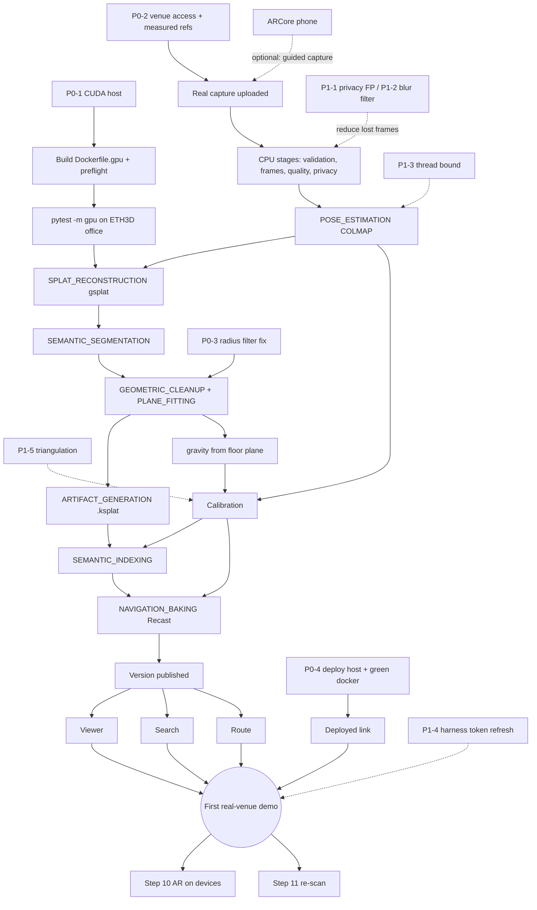

# Implementation baseline: specification reconciled with verified implementation (2026-10-24)

**Purpose.** This is the evidence-based starting point for further feature work. It sets the product flow and
*Chaya_02_Winning_Solution.docx* against what the repository actually does, and records the strongest evidence each
capability has reached. It adds no feature and changes no production behaviour.

**Inputs.**

| Input | Identity |
|---|---|
| Code | `main` at `3815ba6` (local). It is **3 commits ahead of `origin/main` (`e96d477`)**: `f672b7f`, `6929948` and `3815ba6` are unpushed, so CI has never run them. |
| Solution document | `Chaya_02_Winning_Solution.docx` ("Full Technical & Business Blueprint", September 2026), SHA-256 `3735c2b31028f8a8bd6163efa16e63a8de0c1e7bb76a2fa3d34faa29dcbfe11a`. It is **not in the repository**. It was read from the owner's machine and is cited below by its own section numbers (§3 Features, §4 Stack, §5 Infrastructure, §6 Risk, §7 Workflow, §9 Business, §10 Why this wins). |
| Host | Windows 11, Intel Core Ultra 5 125H, 16 GB RAM, **Intel integrated graphics only (no CUDA)**, Docker Desktop 29.6.2 (7.5 GiB VM), 39 GB free on C:. **No Android or iOS device, and no Mac.** |
| Prior records (kept unchanged) | [FINAL_AUDIT_2026-10-17.md](FINAL_AUDIT_2026-10-17.md), [VALIDATION_2026-10-19.md](VALIDATION_2026-10-19.md), [gaussian-splatting-final-verification.md](gaussian-splatting-final-verification.md) (with its 2026-10-23 re-verification), [BASELINE_AUDIT_2026-10-09.md](BASELINE_AUDIT_2026-10-09.md), [E2E_VALIDATION.md](E2E_VALIDATION.md) |

Everything below was either **run on 2026-10-24** (tagged **[run]**), read from GitHub Actions on 2026-10-24
(**[CI]**, with the commit), or taken from a dated record in this repository (**[doc: file]**, not re-run). Nothing is
estimated. Synthetic or public data is always named as such.

## Validation levels

Each level is its own claim. A higher level is never implied by a lower one, and a level can be skipped (a capability
can be integration-tested but never fixture-validated).

| Level | Meaning in this report |
|---|---|
| **Specified** | Described in the solution document or a repository design doc. No code does it. |
| **Implemented** | Code exists that does the real work when its dependencies are present. Compiling is not evidence of working. |
| **Unit-tested** | Automated tests exercise it in isolation, with dependencies stubbed or absent. |
| **Integration-tested** | Automated tests exercise it against real collaborators: Postgres/pgvector, MinIO, Keycloak, ClamAV, the real worker against the real API, or the real external tool (COLMAP, Recast, Open3D). |
| **Fixture-validated** | The real code ran on committed or downloaded fixtures. These are synthetic scenes, or public real data (the ETH3D `office` photos and the outdoor Sceaux photos). **Public real data stays at this level**: it is not the project's venue, and no operator captured it. |
| **Real-venue executed** | It ran through this pipeline on a capture of a real indoor venue made for Chaya, with measured references. **Nothing has reached this level.** |
| **Physical-device validated** | It ran on the target hardware: an ARCore phone, an iPhone, or a CUDA GPU worker. **Nothing has reached this level.** |

---

## 1. Baseline report

### Summary

- **The control plane is real and well tested.** That covers identity and tenancy, upload security, the Postgres job
  queue, artifact sealing, scan versions, search, server-side routing on real Recast output, and the operations
  dashboard. It is integration-tested against real services. The cross-service acceptance suite passes **40/40** in
  CI on `e96d477` [CI], on a synthetic scene.
- **Real data has reached Structure-from-Motion and no further.** On ETH3D `office`, 26 real DSLR photos of one office
  room went through upload, validation, privacy and COLMAP. **14 of 21 kept frames registered**, with 1.7 mm
  camera-centre RMSE against laser ground truth, and a metric calibration was accepted 1.67 % from ground truth
  [doc: VALIDATION_2026-10-19.md]. This is public data, not a venue (**Fixture-validated**).
- **Every stage after SfM has never run on real data.** gsplat has never trained on any machine. `Dockerfile.gpu` has
  never been built. `gpu.yml` has **0 runs** [CI]. So no real `.ksplat`, cleaned cloud, segmentation, detection,
  navmesh, route, AR session or re-scan exists.
- **Nothing is deployed.** The `deploy` workflow has **0 successes in 72 runs** (50 skipped, 19 failed, 3 cancelled)
  [CI]. The last failure is the gate working as designed: `CI did not pass for d3bfaf5: security: failure`.
- **CI on `main` is not green.** `python` (open3d job), `docker` (worker image), `security` (maven), `acceptance`
  (browser A6/B6) and `ios` (app) are red. Causes are in §1.3.

### P0: blocks the first real-venue demonstration, or the submission would be false as written

| ID | Problem | Evidence | Smallest next action | Blocked by |
|---|---|---|---|---|
| P0-1 | **No CUDA GPU host.** gsplat has never trained, `Dockerfile.gpu` has never been built, and `gpu.yml` has never run. Every capability from step 4b onward is unexercised on real data. | `gh run list --workflow gpu.yml` empty [CI]; [gaussian-splatting-gpu-environment.md](gaussian-splatting-gpu-environment.md) §2; this host has Intel graphics only | Provision an L4/A10G-class host (driver ≥ 560, NVIDIA Container Toolkit, ≥ 80 GB disk). Build `services/reconstruction/Dockerfile.gpu`, run `python -m chaya_worker.splat_preflight`, then `CHAYA_REQUIRE_GPU=1 pytest -m gpu` with `CHAYA_SPLAT_DATASET` set to the ETH3D `office` COLMAP project. | Hardware or budget (owner) |
| P0-2 | **No real venue capture exists.** No operator has captured a venue with a phone, with measured references and with the objects the demo will search for (staircase, reception, elevator, exit). ETH3D has none of those objects. | [VALIDATION_2026-10-19.md](VALIDATION_2026-10-19.md) Phase 4 ("NOT TESTABLE on this dataset") | Choose a venue with access permission. Measure ≥ 3 control distances. Capture by the [REAL_VENUE_ACCEPTANCE.md](REAL_VENUE_ACCEPTANCE.md) procedure. | Site access (owner) |
| P0-3 | **GEOMETRIC_CLEANUP's radius filter thins real surfaces** (`cleanup_radius_nb_points = 8` at `services/reconstruction/chaya_worker/settings.py:132`). It keeps about 41 % of an irregularly sampled floor or wall, so PLANE_FITTING then misses planes. This sits on the critical path to a navmesh on real geometry. Raised from P1-14 in FINAL_AUDIT, because the first real splat would hit it. | CI `python` → `open3d` on `e96d477`: `test_geometric_cleanup_and_plane_fitting_run_on_a_real_synthetic_room - assert 1 >= 2` [CI]; analysis in FINAL_AUDIT P1-14 | Retune the radius filter so the expected neighbour count is well above the threshold. Keep the failing test as it is. Re-run B2 and B2c. | — (CPU work; Open3D image) |
| P0-4 | **No deployed environment.** There is no always-on link for judges, and `deploy` has never succeeded. It is gated on a green `docker`, which is red: the worker image has 2 HIGH `libexpat1` CVEs (CVE-2025-59375, CVE-2026-77214; fixed in `2.5.0-1+deb12u5`). | [CI] `docker` run 39817750800; `deploy` history above | Rebuild the worker image on an updated Debian base. Then provision a host, DNS and secrets, and run `deploy` once, including one deliberate failed deploy. | Host, DNS, secrets (owner) |
| P0-5 | **The solution document misstates the delivered system.** Examples: "fine-tuned" models, FAISS, Redis, GLOMAP primary, card-free always-on hosting, AprilTag, a 3D coverage heatmap and sparse point cloud, Z-axis floor segmentation, a PSNR/SSIM ablation, real-device tests, a usability test, a venue conversation, and §10's "each with a solution that was actually run". | §3 and §6 of this report | Revise the document using §3 and §6 before any submission. | — |

### P1: on the demo path, or CI red

| ID | Problem | Evidence | Smallest next action |
|---|---|---|---|
| P1-1 | **Privacy false positives cost real frames.** The Haar face detector found 11 "faces" in an empty office and masked up to 83 % of one frame, and that frame failed to register (D1). | `services/reconstruction/chaya_worker/privacy/detectors.py:4`; VALIDATION D1 | Measure precision and recall on labelled indoor frames, with and without people. Then replace the detector. |
| P1-2 | **FRAME_QUALITY_FILTER rejects sharp, low-texture frames as blurred.** Laplacian variance measures texture, not focus (D2). Indoor venues are mostly plain walls. | VALIDATION D2 | Use an edge-normalised blur measure, or a threshold relative to neighbouring frames. Add the real frame as a regression case. |
| P1-3 | **COLMAP thread count has no memory bound.** It was OOM-killed at 2.5 GB on 18 threads (D3). | VALIDATION D3 | Derive `COLMAP_NUM_THREADS` from available memory. |
| P1-4 | **`scripts/acceptance/real_venue.py` reads its token once**, so a real run longer than the 5-minute access token fails (D4). The 2026-10-19 run needed an 8-hour test client to work around it. | VALIDATION D4 | Refresh the token, or re-read the token file per request. |
| P1-5 | **Calibration needs manual triangulation**, and points marked in frames that never register are accepted silently (D6). | VALIDATION D6; ARCHITECTURE.md §7a | After POSE_ESTIMATION, report which measurements have ≥ 2 registered views. Triangulate through `poses.json`. |
| P1-6 | **`acceptance` red:** browser checks A6/B6 fail on a console error. The report-only CSP's `frame-src` is fixed at build time, but `CHAYA_PUBLIC_OIDC_ISSUER` arrives only at runtime (D5). The 40/40 service tests pass. | [CI] run 40073568175; `apps/web/next.config.ts:25` | Emit the CSP per request from runtime configuration, or pass the issuer as a build argument. |
| P1-7 | **`security` red:** `tika-core` 3.2.2 has CVE-2026-66755 (CVSS 7.5, fixed in 3.3.2). | [CI] run 39817751013 | Bump Tika and re-run `mvn verify`. |
| P1-8 | **`ios` red:** `ReferenceImageTests.testMissingAndMalformedImagesAreRejected` fails because a truncated PNG is not rejected (`AppLevelTests.swift:173`). It has not run since `e47948b`. | [CI] run 39204149235 | Make `ReferenceImages.make` detect truncation on Apple's decoder. This needs a macOS run. |
| P1-9 | **GLOMAP is in no image.** The document calls it the primary mapper. | §3.3 | Decide (§3.3: recommend COLMAP primary). |
| P1-10 | **The default SegFormer weights are licensed for research or evaluation only.** | [ML_EVALUATION.md](ML_EVALUATION.md) §1 | Choose a commercially licensed segmentation base. |
| P1-11 | **Android AR requires a Keycloak sign-in.** `apps/web/components/ArWorkspace.tsx` has no public-viewer session path; iOS accepts a viewer link. The document promises no login on site. | `ArWorkspace.tsx:778`; no `PublicViewer` references in it | Accept the viewer-link session on `/ar`, as `ViewerWorkspace.tsx` does. |
| P1-12 | **Re-scan DIRECT alignment falsely rejects a region dominated by a moved object.** It fails safe. | FINAL_AUDIT P1-11 | Design and benchmark (B5) a refinement before touching the gates. |
| P1-13 | **3 unpushed commits** (splat quality gates, checkpoint-error handling, seed placement) have never run in CI. | `git status` [run] | Push them and read every workflow result. |
| P1-14 | **A reopened PARTIAL run whose resumed attempt fails other than by the time budget has untested status handling** (audit V-1). | [gaussian-splatting-final-verification.md](gaussian-splatting-final-verification.md), "Remaining unverified" | Add a control-plane test before the first GPU run. |

### P2: deviations, completeness, polish

- No Z-axis floor segmentation: floors are separate captures, and staff enter connections.
- No background refinement after a time-budget overrun: PARTIAL is kept and never refined.
- Keycloak events are not in `audit_log`.
- No Checkstyle or SpotBugs: `services/api/pom.xml` has neither.
- No CDN.
- No off-site backup copy, and Keycloak's database is not in `scripts/backup/backup.sh`.
- The capture HUD has a 2D coverage grid, with no sparse point cloud and no 3D heatmap.
- Image-target markers, not AprilTag.
- Routing is server-side; there is no Detour WASM client.
- The API runs as a single instance (ARCHITECTURE.md §3.1).
- The legacy job endpoints remain (BASELINE_AUDIT_2026-10-09 F6).
- No usability test, no device performance figures, and B2–B6 have not been re-run.
- Documentation drift (§7).

### 1.3 CI state (read 2026-10-24)

| Workflow | Latest on `main` | Result | Cause |
|---|---|---|---|
| `backend` | `e96d477` | success | — |
| `frontend` | `fb69c33` | success | (path-filtered; not triggered since) |
| `reconstruction-smoke` | `e96d477` | success | — |
| `python` | `e96d477` | **failure** | `open3d` job: P0-3. The other jobs (`test (reconstruction)`, `test (vision)`, `minio-integration`) pass. |
| `docker` | `e96d477` | **failure** | `image (worker)`: 2 HIGH in `libexpat1` (P0-4). The `api`, `web` and `vision` images pass. |
| `security` | `e96d477` | **failure** | `maven`: `tika-core` CVE-2026-66755 (P1-7) |
| `acceptance` | `e96d477` | **failure** | 40/40 service tests pass; browser A6/B6 fail (P1-6) |
| `ios` | `e47948b` | **failure** | `app`: P1-8. `core` passes. |
| `deploy` | — | **never succeeded** | Skipped or gated behind red CI |
| `gpu` | — | **never run** | There is no self-hosted `gpu` runner |

---

## 2. Requirement-to-code traceability matrix

Paths are relative to the repository root. `API` stands for `services/api/src/main/java/dev/chaya/api`, `APIT` for
`services/api/src/test/java/dev/chaya/api`, `W` for `services/reconstruction/chaya_worker` and `WT` for
`services/reconstruction/tests`. Every path in this table was checked to exist at `3815ba6` (§8). Test counts from
2026-10-24 are in §5.

| # | Product requirement | Intended user outcome | Existing implementation and exact file paths | API / data contract dependencies | Tests currently proving it | Strongest evidence level | Known defects and missing prerequisites | Required acceptance test | Priority and dependencies |
|---|---|---|---|---|---|---|---|---|---|
| 1a | Operator captures a venue and uploads media | Video or photos from the site reach the backend, and resume after network loss | `apps/web/components/CaptureWorkspace.tsx`, `apps/web/lib/uploader.ts`, `apps/web/lib/capture-queue-idb.ts`; `API/capture/CaptureController.java`, `API/capture/MediaService.java` | `POST /venues/{v}/captures`, `…/media`, `PUT …/parts/{n}`, `…/complete-upload`; V9 `capture_media`, `capture_media_part` | `APIT/CaptureIngestionTest.java`, `APIT/CaptureOfflineRecoveryTest.java`, `apps/web/e2e/capture-offline.spec.ts`; acceptance 2.x [CI] | **Integration-tested.** Fixture-validated with 27 real ETH3D files [doc] | `/capture` uploads files recorded elsewhere; there is no in-browser recording. Never uploaded from a phone over mobile data. | Device checklist §6 #9 (FINAL_AUDIT): phone upload over mobile data, interrupted and resumed | P1; needs a phone |
| 1b | Capture with a phone tracking position | The operator's walk is tracked in metres while capturing | `apps/web/lib/capture-xr-session.ts`, `apps/web/lib/capture-xr-gl.ts` (device-only), `apps/web/lib/capture-tracking.ts` | `…/hud/pose` (`source: webxr`); V-HUD tables | `apps/web/lib/capture-tracking.test.ts`; `APIT/CaptureHudApiTest.java` | **Integration-tested** (API). WebXR code is Implemented only. | Never ran in an `immersive-ar` session on an ARCore device. iOS has no capture client (`arkit` is accepted, but nothing posts it). | One guided capture on an ARCore phone, with the HUD export recorded | P1; needs an ARCore phone |
| 2a | Guided coverage: recon lap → bounds → scan plan | The operator is told where to walk to cover the room | `API/planning/RoomBoundsEstimator.java`, `API/planning/CapturePathPlanner.java`, `API/hud/CapturePlanService.java`; `apps/web/components/CaptureHud.tsx`, `apps/web/lib/capture-guidance.ts`, `apps/web/lib/capture-minimap.ts` | `…/hud/reconnaissance`, `…/hud/scene/estimate`, `…/hud/plan`, `…/route-plan` | `APIT/CapturePlanApiTest.java`, `APIT/planning/RoomBoundsEstimatorTest.java`; benchmark B1 (`benchmarks/b1_capture_path`) | **Fixture-validated** (synthetic floor plans, B1) [doc: FINAL_AUDIT] | Guidance is a 2D minimap plus the next waypoint, with **no AR breadcrumbs** (`capture-xr-gl.ts`: "Nothing is rendered"). "Optimal" is not established: the planner is heuristic. | The same guided capture: planned vs. observed coverage | P1; needs 1b |
| 2b | Detect poor-quality or missing coverage on site | Blur, low texture and gaps are flagged before leaving | `apps/web/lib/capture-quality.ts` (Laplacian variance, FAST-corner count), `apps/web/lib/frame-quality.ts`; `API/hud/CaptureHudService.java` (coverage grid, SSE) | `…/hud/quality`, `…/hud/status`, `…/hud/stream` | `apps/web/lib/capture-quality.test.ts`; `APIT/CaptureHudApiTest.java` | **Integration-tested** | Coverage is a **2D grid computed by the server**; there is no point cloud and no 3D heatmap. The same sharpness score misjudges low-texture frames (P1-2). | Reshoot flags on a real capture compared with the frames SfM failed to register | P1 (P1-2); P2 (3D) |
| 3a | Safe ingestion | Only verified, scanned, correctly typed media enters the pipeline | `API/capture/TikaContentTypeDetector.java`, `API/capture/ClamAvScanner.java`, `API/capture/MediaValidationService.java`, `API/security/RateLimiter.java` | Media states `PENDING→VALIDATING→ACCEPTED/REJECTED/QUARANTINED`; DB trigger | `APIT/UploadValidationTest.java`, `APIT/CaptureIngestionTest.java`, `APIT/ClamAvLiveTest.java` (opt-in); acceptance 2.7–2.9 (real ClamAV, EICAR) [CI] | **Integration-tested.** Fixture-validated on 27 real files [doc] | Rate limits are per instance. There is a ClamAV size limit for videos over 2 GiB [doc: FINAL_AUDIT]. | Included in the real-venue run | Done for scope |
| 3b | Asynchronous processing | Long jobs never block requests, and they survive worker loss | `API/pipeline/PipelineService.java`, `API/pipeline/PipelineEnforcer.java`, `API/job/` ; `W/orchestrator.py`, `W/api_client.py` | `POST /internal/jobs/claim`, `/{j}/heartbeat`, `/{j}/report`; `packages/contracts/pipeline/stage-artifacts.json` | `APIT/PipelineControlPlaneTest.java`, `APIT/JobRecoveryTest.java`, `WT/orchestration/test_stages_and_orchestrator.py`; acceptance 3.x [CI] | **Integration-tested.** Real OOM failure and bounded retry on ETH3D [doc] | — | — | Done for scope |
| 4a | Structure-from-motion | Camera poses for every usable frame | `W/stages/pose_estimation.py` (COLMAP; GLOMAP only if on PATH) | `SPARSE_MODEL`, `POSES` | `WT/unit/test_reconstruction_pipeline.py` (tools stubbed); `WT/gpu/test_reconstruction_toolchain.py` (not run) | **Fixture-validated** (real ETH3D indoor photos, CPU COLMAP 3.8, test-only image) [doc] | GLOMAP is absent everywhere (P1-9). OOM at default threads (P1-3). 33 % of kept frames did not register. | Real venue: registration ratio ≥ 0.6 on the phone capture | P0 via P0-2; P1-3, P1-9 |
| 4b | 3D Gaussian Splatting | A trained, viewable reconstruction of the venue | `W/stages/splat_reconstruction.py`, `W/splat_training.py`, `W/splat_quality.py`, `W/splat_preflight.py`; `services/reconstruction/Dockerfile.gpu`; V43 resume | `SPLAT`, `SPLAT_PARTIAL`, `SPLAT_CHECKPOINT`, `SPLAT_TRAINING_REPORT` | `WT/splat/*` (CPU test renderer, not gsplat); `APIT/SplatResumeControlPlaneTest.java`; `WT/gpu/test_splat_acceptance.py` **never run** | **Unit-tested** (training mechanics on CPU), plus control-plane integration. **gsplat: Implemented only.** | Never executed (P0-1). The D-5 quality thresholds are floors, not measurements. Background refinement is not implemented. | GPU acceptance on ETH3D `office`, then on the venue: held-out PSNR above the seed, and a COMPLETED (not PARTIAL) run | **P0-1**; needs a GPU host |
| 5a | Metric calibration | Distances in the twin are metres | `API/frame/CoordinateFrameService.java`, `API/capture/CaptureCalibrationService.java`; `apps/web/components/CalibrationPanel.tsx` | `…/captures/{c}/measurements`, `…/calibration`; `coordinate_frame` | `APIT/CaptureCalibrationTest.java`, `APIT/CoordinateFrameCalibrationTest.java` | **Fixture-validated** (ETH3D: scale 1.67 % low, gravity not aligned) [doc] | Manual triangulation; silent acceptance of unregistered marks (P1-5). Gravity needs a floor plane, which needs 4b. | RMS against ≥ 3 tape-measured distances on the venue | P1-5; needs 4b for gravity |
| 5b | Geometry cleanup | Floaters removed, and floors and walls kept | `W/stages/geometric_cleanup.py`, `W/stages/plane_fitting.py`, `W/geometry_cleanup.py` (Open3D) | `SPLAT_CLEAN`, plane report | `WT/gpu/test_reconstruction_toolchain.py` (**failing in CI**); acceptance 3.x (real Open3D, synthetic lattice); B2 | **Integration-tested** (real Open3D, synthetic) | Radius-filter defect (P0-3). No PSNR/SSIM ablation exists. | Cleanup on the first real splat: plane count, and inlier share of floor and walls | **P0-3**; then needs 4b |
| 6a | Semantic segmentation | Splats labelled floor, wall, furniture, clutter | `W/stages/semantic_segmentation.py`, `W/semantic_classes.py`; `W/training/segmentation.py` (harness) | `SEMANTIC_LABELS` (`commercial_use: false`) | `WT/unit/test_semantic_models.py`; `WT/ml/test_training_smoke.py` (ML image only); B6 | **Fixture-validated** (stock SegFormer on 102 COCO indoor images, mIoU 0.548) [doc: ML_EVALUATION.md] | Stock checkpoint with a research-only licence (P1-10). No fine-tuned model. A stand-in replaces it in acceptance. | Label counts and a reviewed frame sample on the venue | P1-10; needs 4b |
| 6b | Object detection and indexing | Searchable objects with 3D positions | `W/stages/semantic_indexing.py`, `W/grounding_dino.py`, `W/clip_embeddings.py`, `W/object_localization.py` | `poi`, `poi_version.embedding vector(512)` (V5, V21; HNSW) | `WT/unit/test_semantic_indexing.py`, `WT/unit/test_object_localization.py`; B6 | **Fixture-validated** (stock Grounding DINO, mAP@0.5 0.500 on 4 COCO classes) [doc] | Stock checkpoint. A stand-in replaces it in acceptance. Needs a calibrated frame. | ≥ 10 real objects detected and localised on the venue | needs 4b, 5a |
| 6c | Destination search | "Find the reception" returns the right place | `API/search/SemanticSearchService.java`, `API/search/QueryInterpreter.java`, `API/search/PoiEmbeddingBackfill.java`; `services/vision/app`; `apps/web/components/SemanticSearchPanel.tsx`, `apps/web/lib/voice-input.ts` | `GET /venues/{v}/search`, `…/pois`; `search_query` | `APIT/SemanticSearchServiceTest.java`, `APIT/SemanticSearchRankingTest.java`, `APIT/SearchBenchmarkTest.java` (real CLIP vectors); `apps/web/e2e/search.spec.ts`; acceptance 5.x with the real vision service [CI] | **Integration-tested.** Fixture-validated (B3: real CLIP on COCO crops) [doc] | Relevance on a venue is unmeasured. pgvector, not FAISS (§3.1). | 10 real queries, top-3 judged by a person | needs 6b |
| 7 | Navmesh and routing graph | Routes only over walkable floor, with a step-free option | `W/stages/navigation_baking.py`, `services/reconstruction/native/chaya-navmesh/src/main.cpp` (recastnavigation 1.6.0); `API/navigation/RouteService.java`, `API/navigation/CorridorPath.java`, `API/navigation/FloorConnectionService.java` | `NAVMESH`, `NAVMESH_MANIFEST`; `navigation_graph`/`_node`/`_edge`, `floor_connection`; `NAVMESH_NOT_READY` | `WT/navmesh/*` (real Recast); `APIT/RealNavmeshNavigationTest.java`, `APIT/RouteServiceTest.java`; acceptance 6.x [CI] | **Fixture-validated** (real Recast on synthetic venues) | Never baked from real geometry; P0-3 sits upstream. Floors and connections are entered by staff. | 5 routes walked on site, including one step-free and one multi-floor; walked length vs. route length | needs 5b, 5a |
| 8 | Web viewer shows the real venue | Anyone with a link sees the reconstructed venue | `apps/web/components/SplatViewerCanvas.tsx`, `apps/web/components/ViewerWorkspace.tsx`, `apps/web/lib/artifact-integrity.ts`; `W/stages/artifact_generation.py`, `W/ksplat.py`; `API/pipeline/KsplatValidator.java`, `API/publiclink/PublicViewerService.java` | `…/reconstructions/latest`, `…/artifacts/{kind}` (`KSPLAT`); `public_viewer_link` | `apps/web/e2e/ksplat-viewer.spec.ts`, `apps/web/e2e/viewer.spec.ts`; `WT/smoke/test_splat_artifact_smoke.py`; `APIT/KsplatPublicationTest.java`, `APIT/PublicViewerLinkTest.java`; acceptance browser B1–B5 [CI] | **Fixture-validated** (synthetic `.ksplat`, software WebGL) | No real `.ksplat` exists (needs 4b). CSP console error (P1-6). No device frame-rate figures. | Real `.ksplat` on desktop and a low-end phone: load time and median frame time | needs 4b, P0-4 for a public link |
| 9 | Search → valid route | A user picks a destination and receives a valid route | `apps/web/lib/navigation-api.ts`, `apps/web/lib/multi-stop.ts`, `apps/web/lib/viewer-route.ts`; `API/navigation/NavigationController.java` | `POST /navigation/routes`, `…/routes/multi-stop` | `APIT/RoutePlanApiTest.java`; `apps/web/e2e/search-navigation.spec.ts` (API mocked); acceptance 6.x [CI] | **Integration-tested** | Same as rows 6c and 7 | Covered by row 7's walked routes | needs 6c, 7 |
| 10a | Android WebXR guidance | A phone overlays the route in the venue | `apps/web/components/ArWorkspace.tsx`, `apps/web/lib/ar-navigation.ts`, `apps/web/lib/ar-route-renderer.ts`, `apps/web/lib/webxr-support.ts` | `…/floors/{f}/anchors`, `…/anchors/relocalize`, routes | `apps/web/lib/ar-navigation.test.ts`; `apps/web/e2e/ar.spec.ts` (unsupported states only) | **Unit-tested** | Never ran on a phone. Requires sign-in (P1-11). | [ar-android-validation.md](ar-android-validation.md) on one ARCore phone | needs a phone, 7, 10c |
| 10b | iOS ARKit guidance | An iPhone overlays the route | `apps/ios-ar/Sources/ChayaARKitSession/ARSessionManager.swift`, `apps/ios-ar/Sources/ChayaARKitSession/RouteSceneRenderer.swift`, `apps/ios-ar/App/ChayaAR/Sources/NavigationViewModel.swift`, `apps/ios-ar/Sources/ChayaARCore/APIClient.swift` | Same path-data API; viewer-link exchange | `apps/ios-ar/Tests/ChayaARCoreTests/*` (83, Linux Swift) [run]; `apps/ios-ar/App/ChayaARTests/AppLevelTests.swift` (**red in CI**) | **Unit-tested** (core). The ARKit layer is Implemented only (`swiftc -parse` here). | Never ran on a device. App XCTest red (P1-8). | [ar-ios-validation.md](ar-ios-validation.md) on one iPhone | needs an iPhone and a Mac, 7, 10c |
| 10c | Multi-anchor relocalization and drift control | The overlay stays aligned along the route | `apps/web/lib/ar-relocalization.ts`, `apps/web/lib/ar-anchor-math.ts`; `apps/ios-ar/Sources/ChayaARCore/RelocalizationStateMachine.swift`, `apps/ios-ar/Sources/ChayaARCore/AnchorMath.swift`, `apps/ios-ar/Sources/ChayaARCore/FloorHandoff.swift`; `API/ar/AnchorService.java`, `API/ar/ImageTarget.java` | `ar_anchor`, `ar_anchor_pose`; `…/anchors/{a}/target.png` | `APIT/AnchorServiceTest.java`; web and Swift unit tests | **Integration-tested** (API), unit-tested (math) | Image targets, not AprilTag. Drift has never been measured. | Drift at 3 taped checkpoints with 2 markers | needs devices |
| 10d | Obstacle rerouting from the AR camera | A blocked corridor triggers a new route | `apps/web/lib/obstacle-sensing.ts`, `apps/web/lib/ar-depth-obstacles.ts`, `apps/web/lib/obstacle-reroute.ts`; `apps/ios-ar/Sources/ChayaARCore/ObstacleSensing.swift`, `apps/ios-ar/Sources/ChayaARKitSession/ObstacleSensor.swift` | `POST /navigation/routes` `blockedRegions` | web unit, Swift unit (synthetic depth); acceptance 6.8 (server exclusion) [CI] | **Unit-tested** (sensing), integration-tested (server exclusion) | Depth-based only; Android has no person classifier. Never on a device. | ar-android-validation.md §6d; iOS obstacle checklist | P2; needs devices |
| 11 | Update a changed region without losing the previous version | A re-scan replaces only the changed area; the old version stays served | `API/rescan/RescanService.java`, `API/rescan/ScanVersionService.java`; `W/stages/region_alignment.py`, `W/stages/region_splice.py`; `apps/web/components/RescanStart.tsx` | `POST …/floors/{f}/rescan`, `…/scan-versions`; `scan_version`, `scan_version_artifact`, `floor.current_scan_version_id` (V28) | `APIT/RescanControlPlaneTest.java`, `APIT/ScanVersionImmutabilityTest.java`, `APIT/ScanVersionPublicationTest.java`; `WT/orchestration/test_rescan_stages.py`; acceptance 7.x [CI]; B5 | **Integration-tested** (versioning). Fixture-validated (alignment on synthetic geometry and B5's real SfM cloud) | DIRECT false rejection (P1-12). Needs a real base reconstruction (4b). | Move one object, re-scan, check the gates, splice and navmesh outside the region; the old version is still served byte-exact | needs 4b; P1-12 |
| 11b | Multi-room stitching | Rooms scanned separately form one floor | `W/stages/room_registration.py`, `W/stages/room_stitch.py`; `API/stitch/StitchService.java`; V41 | `POST …/floors/{f}/stitches` | `APIT/StitchControlPlaneTest.java`; `WT/unit/test_room_registration.py`; `WT/gpu/test_room_registration.py` (real FPFH, manual) | **Fixture-validated** (synthetic floor; 0/5 stitched, none misplaced) [doc] | Not tuned on real rooms | A two-room real capture | P2; needs 4b |
| 12a | Monitor processing and failures | Operators see what runs, what failed and why | `API/ops/OpsDashboardService.java`, `apps/web/components/OpsDashboard.tsx`, `apps/web/lib/processing-live.ts`; `API/capture/ProcessingBroadcaster.java` (SSE) | `GET /venues/{v}/ops/*`, `…/processing/stream` | `APIT/OpsDashboardApiTest.java`, `APIT/ProcessingLiveStatusTest.java`; `apps/web/e2e/ops.spec.ts`; acceptance 8.x [CI] | **Integration-tested** | Browser checks use a mocked API | Dashboard screenshots after the venue run | Done for scope |
| 12b | Scan freshness | Stale venues are visible | `API/ops/OpsDashboardService.java` | `ops/overview`, `ops/coverage` | `APIT/OpsDashboardApiTest.java` | **Integration-tested** | — | Same | Done for scope |
| 12c | Costs | Real processing cost per run | `API/cost/ResourceUsageRecorder.java`, `API/cost/RateCard.java`; `W/resources.py`; V42 | `ops/resources`; `job_attempt_usage`, `cost_rate_set`, `infrastructure_bill` | `APIT/ResourceCostTest.java`, `APIT/ResourceCostWithoutRatesTest.java`; `WT/unit/test_resources.py` | **Integration-tested.** Measured wall and CPU time on the ETH3D run; cost `NO_RATES_CONFIGURED` [doc] | No GPU, no rate card, no provider bill | Record a real GPU bill and compare it with the estimate | needs P0-1 |
| 12d | Audit events | Who did what, and when | `API/audit/AuditService.java`, `API/audit/AuditLogWriter.java`; V7 `audit_log` | `GET /audit-log` | `APIT/AuditLogTest.java` | **Integration-tested** | Keycloak events are not forwarded | — | P2 |
| X1 | Identity and tenant isolation | Venues are isolated; roles enforced | `API/security/SecurityConfig.java`, `API/security/TenantGuard.java`; `infra/keycloak/chaya-realm.json` | JWT claims `org_id`, `venue_id`; 404 across tenants | `APIT/TenantApiIsolationTest.java`, `APIT/CrossTenantResourceIsolationTest.java`, `APIT/RoleAuthorizationTest.java`; acceptance 1.x (real Keycloak) [CI] | **Integration-tested** | Organisations are created in SQL | — | Done for scope |
| X2 | Privacy before reconstruction | Faces and screens blurred; raw PII purged | `W/privacy/detectors.py`, `W/privacy/masks.py`, `W/stages/privacy.py`; `API/erasure/ErasureService.java` | `FRAME_ARCHIVE_ANON`, `PRIVACY_MASKS`; `pii/` prefix | `APIT/PrivacyLifecycleTest.java`, `APIT/ErasureTest.java`; `WT/orchestration/test_privacy_masks.py` | **Fixture-validated** (ETH3D: runs and purges, but false positives) [doc] | Haar cascades and a heuristic quad, not RetinaFace/MediaPipe or YOLOv8 (P1-1). Recall never measured. | Privacy review on venue frames with people and screens | P1-1 |
| X3 | Deployment | An always-on environment | `infra/deploy/docker-compose.yml`, `infra/deploy/deploy.sh`, `.github/workflows/deploy.yml`, `scripts/ci/require-green.sh` | `/api/v1/health` | `scripts/deploy/test-deploy.sh` (stubbed); production-like local run [doc: DEPLOYMENT.md §11] | **Unit-tested** (script control flow), plus a local production-like run | Never deployed (P0-4) | One successful `deploy` run and one deliberate failure with rollback | **P0-4** |
| X4 | Backup and recovery | Data survives host loss | `scripts/backup/backup.sh`, `scripts/backup/restore-drill.sh` | — | `scripts/backup/test-restore-drill.sh`; stack-smoke restore drill [CI `reconstruction-smoke`] | **Integration-tested** | No off-site copy; Keycloak DB not included | A restore drill on venue data | P2 |

---

## 3. Specification reconciliation and recommended decisions

### 3.1 FAISS (document §3, §4) vs. PostgreSQL + pgvector (repository)

- **The document contradicts itself.** §3 and §4 name FAISS; §5.2 chooses "pgvector extension on the same Postgres
  instance … avoids running a separate vector DB".
- **The repository:** `poi_version.embedding vector(512)` with an HNSW index
  (`services/api/src/main/resources/db/migration/V5__poi.sql`, `V21__search_embedding_spaces.sql`), queried by
  `SemanticSearchService.java`. There is no FAISS dependency anywhere in `services/` or `apps/` [run: grep].
- **Decision: keep pgvector.** It keeps tenant filtering and versioning in the same transaction as POIs, and adds no
  service to back up. FAISS would only make sense for an index far larger than a venue's POIs. Correct §3 and §4 of the
  document.

### 3.2 Redis (document §5.2, §5.5) vs. its removal

- **The repository:** Redis was dropped on 2026-10-07 because nothing used it (PROJECT_PLAN.md M2; ARCHITECTURE.md
  §3.1, which also lists exactly what breaks if the API is scaled out). The only Redis-protocol process is GlitchTip's
  own Valkey, inside the optional monitoring stack (`infra/monitoring/docker-compose.yml:25`). It is not part of the
  product.
- **Decision: keep it out.** Re-add Redis only together with code that needs it, such as multi-instance rate limits or
  HUD fan-out, and record that in an ADR. Refresh-token revocation is handled by Keycloak. Correct §5.2 and §5.5.

### 3.3 GLOMAP as the primary mapper vs. deployment images

- **The repository:** `W/stages/pose_estimation.py` uses GLOMAP only if a `glomap` binary is on PATH, and otherwise
  COLMAP's incremental mapper. No image installs GLOMAP. The CPU `Dockerfile` excludes it by design, and neither
  `Dockerfile.gpu` nor `infra/ci/worker-colmap.Dockerfile` installs it.
- **Evidence:** the ETH3D run's toolchain report says "glomap not found" [doc]. COLMAP is the only mapper that has ever
  run.
- **Decision: declare COLMAP the primary mapper now.** Treat GLOMAP as a later optimisation, added to `Dockerfile.gpu`
  only after it has been measured against COLMAP on the same real capture (registration ratio, pose error, time).
  Correct the document and ARCHITECTURE.md §16's wording.

### 3.4 Fine-tuned models vs. stock checkpoints

| Model | Running | Licence | Fine-tuned? |
|---|---|---|---|
| Segmentation | `nvidia/segformer-b0-finetuned-ade-512-512` @ `489d5cd8…` (`Dockerfile.gpu:101-102`) | **research/evaluation only** | No |
| Detection | `IDEA-Research/grounding-dino-tiny` @ `a2bb814d…` | Apache-2.0 | No |
| Embedding | open_clip `ViT-B-32` / `openai` | MIT | No |
| Screen/document (document: YOLOv8-nano) | heuristic quadrilateral detector | — | n/a |
| Faces (document: RetinaFace/MediaPipe) | OpenCV Haar cascades | — | n/a |

- **What exists:** a dataset pipeline and a gated fine-tuning harness (`W/training/`, smoke-tested with tiny random
  models), plus a held-out baseline (B6) [doc: ML_EVALUATION.md].
- **Blockers:** no labelled indoor data from the project's own scans (that needs 4b), no GPU, and a research-only base
  licence.
- **Decision: present every model as stock.** First switch to a permissively licensed segmentation base. Fine-tuning
  becomes a goal only after the first real venue produces frames to label. "Moat" claims in §9 that depend on
  fine-tuned models stay future goals.

### 3.5 Automatic capture guidance: proposal vs. what runs on supported devices

| Document (§3, §4, §7) | What runs |
|---|---|
| 10-second recon lap → room bounds | Implemented: the HUD records a reconnaissance walk; `RoomBoundsEstimator` runs **on the server** |
| Optimal secondary path via **live AR breadcrumbs** | Heuristic planner (`CapturePathPlanner`) on the server. The browser shows a **2D minimap and the next waypoint**. The AR session renders nothing (`apps/web/lib/capture-xr-gl.ts`). |
| On-device SLAM-lite, sparse point cloud, 3D heatmap, "no server round-trip" | **None of these.** Positions come from ARCore through WebXR. Coverage is a 2D grid computed by the API and pushed over SSE. |
| Per-frame blur scoring | Implemented in the browser (Laplacian variance, plus FAST-corner texture as the ORB pre-flight). It shares the texture-vs-blur flaw of P1-2. |
| Supported devices | Chrome on an ARCore Android phone (WebXR `immersive-ar`). **iOS: none**: the iOS app does navigation only. Desktop or other: manual marks or an imported trajectory. |
| Validation | **No session has ever run on a device.** B1 is synthetic. |

**Decision:** describe it as "guided capture with a reconnaissance-lap scan plan, 2D coverage and per-frame quality
checks on Android Chrome". The 3D heatmap and AR breadcrumbs become future features, and none should be built before
one real guided capture shows whether the 2D guidance is enough.

### 3.6 Always-on deployment: proposal vs. evidence

- **The document (§5.4):** Vercel/Netlify for the viewer, Render for the API, Neon Postgres, UptimeRobot, Kaggle/Colab
  GPU, and a DuckDNS home server as fallback.
- **The repository:** one self-hosted Docker host behind Caddy (`infra/deploy/docker-compose.yml`), deployed by
  `deploy.yml` over SSH after a green-CI gate. None of the proposed platforms is configured. There is no CDN and no
  uptime monitor. Infrastructure for a scripted Kaggle GPU run does not exist.
- **Evidence:** a production-like stack ran on the workstation, with rollback and a restore drill
  [doc: DEPLOYMENT.md §11]. **No real host has ever been deployed.** `deploy` has 0 successes in 72 runs [CI].
- **Decision: keep the single-host design.** The stack needs Keycloak, ClamAV, MinIO and a worker, which Render's free
  tier cannot host. The public deliverable can still be "one VM + Caddy". Provision it (P0-4) before claiming any
  always-on link. Free-tier GPU (Kaggle) for the timed round remains unproven and must be tested before it is relied on.

### 3.7 Promised real-venue benchmarks vs. evidence

| Evidence that exists | Data | Level |
|---|---|---|
| B1 capture planning | synthetic floor plans | Fixture-validated |
| B2 cleanup | a third-party real splat (playroom) and a real SfM cloud; proxy metric, no PSNR/SSIM | Fixture-validated |
| B3 search | real CLIP on COCO crops | Fixture-validated |
| B4 navigation | synthetic venues | Fixture-validated |
| B5 re-scan | a real outdoor SfM cloud with **simulated** misalignment | Fixture-validated |
| B6 models | 102 COCO indoor images | Fixture-validated |
| B7 multi-room | synthetic floor | Fixture-validated |
| ETH3D `office` | 26 real indoor DSLR photos, up to SfM and calibration | Fixture-validated (real public data) |
| Sceaux | 11 real outdoor photos, up to SfM | Fixture-validated (real public data) |

**No benchmark has run on a real venue.** The document's "published-style ablation … PSNR/SSIM table" (§3), "actual
cost-per-1000-sqft" (§9) and "tested with 5 non-technical users" (§6.8) have **no data at all**. They must not appear
with numbers until they are run.

### 3.8 Other discrepancies

| Document | Repository | Decision |
|---|---|---|
| Spring Cloud Gateway size and rate limits (§6.5) | In-process `RateLimiter`; no gateway | Keep; correct the document |
| SQLite job queue on the capture device (§6.3) | IndexedDB queue (`apps/web/lib/capture-queue-idb.ts`) | Keep (a browser has no SQLite); correct the document |
| Recast-Detour in WASM (§4) | Server-side Detour graph plus string-pulling | Keep; correct the document |
| Client-credentials JWT for public links (§5.1) | Opaque, server-checked viewer tokens | Keep (same intent); correct the document |
| Access tokens of ~15 min (§5.1) | 5 min | Keep |
| Realm per tenant (§5.1) | One realm, with tenant claims | Keep until a second customer exists |
| AprilTag fiducials (§3, §4) | Printed image targets; neither WebXR nor ARKit detects AprilTag | Correct the document, or add a detector later (feature) |
| Z-axis floor segmentation (§3) | Floors captured separately; connections entered by staff | Correct the document |
| Background refinement after the time box (§7) | Not implemented; PARTIAL is kept and never published as final | Future goal |
| Checkstyle/SpotBugs (§5.3) | ESLint, ruff; nothing for Java | Add SpotBugs (P2) or correct the document |

---

## 4. Dependency graph to the first real-venue demonstration

"First real-venue demonstration" means steps 1–9 of the product flow on one real venue: capture → reconstruction →
viewer → search → route, shown on a deployed link. AR (step 10) and re-scan (step 11) come after it.



The same graph in text form:

1. **Hard blockers, needing owner action:**
   - **P0-1 GPU host**, which blocks every stage from SPLAT_RECONSTRUCTION on;
   - **P0-2 venue capture**, which blocks real data entirely;
   - **P0-4 deploy host**, which blocks a public link.

   None of these can be solved in code.
2. **Code fix on the critical path:** **P0-3** (the cleanup radius filter). Without it, a real splat's floors are
   likely to lose their planes, which breaks gravity, calibration and the navmesh.
3. **Strongly recommended before the venue run:** P1-1 and P1-2, which lost 12 of 26 frames on ETH3D; P1-3, P1-4 and
   P1-5; P1-13 (push and see CI on the latest commits); P1-14.
4. **Can run in parallel now:** P1-6 to P1-8 (CI red), P1-10 (licence), and the document corrections (P0-5).
5. **After the demo:** AR on devices (step 10, needs both phones), re-scan (step 11), multi-room, and fine-tuning.

The **cheapest de-risking step** is to run GPU acceptance on ETH3D `office`, whose COLMAP project is reproducible from
the 2026-10-19 commands, before visiting a venue. That separates "gsplat works" from "our capture works".

---

## 5. Reproducing the baseline

### 5.1 Run on 2026-10-24 (this host, against `3815ba6`)

| Suite | Command (from the repository root, Git Bash) | Result |
|---|---|---|
| Fixtures | `bash scripts/ci/check-fixtures.sh` | 13 required files committed, checksums match. Exit 0. |
| Web lint | `cd apps/web && npm run lint` | clean |
| Web typecheck | `cd apps/web && npm run typecheck` | clean |
| Web unit | `cd apps/web && npm test` | **385 passed**, 0 failed, 0 skipped |
| Benchmarks framework | `services/reconstruction/.venv/Scripts/python.exe -m pytest -q benchmarks/tests` | 10 passed |
| iOS core | `docker run --rm -v "<HEAD copy>/apps/ios-ar:/src:ro" swift:5.10-jammy bash -c "cp -r /src /tmp/p && cd /tmp/p && swift test"` | **83 passed**, 0 failed |
| Worker lint | `cd services/reconstruction && .venv/Scripts/python.exe -m ruff check .` | clean |
| Worker CPU suite (CI selection) | `PATH=/c/MinGW/bin:$PATH CHAYA_NAVMESH_BIN=<abs path to chaya-navmesh.exe> HF_HUB_OFFLINE=1 .venv/Scripts/python.exe -m pytest -q -rfEs -m "not gpu and not open3d and not integration and not acceptance"` | **731 passed, 2 skipped**, 62 deselected (8 min 38 s). The skips are `tests/ml` (no `transformers` in the host venv; CI installs it) and an empty parameter set (allowlisted). This includes the real Recast/Detour navmesh tests. |
| Worker gated selection (to list what does not run here) | the same with `-m "gpu or open3d or integration or acceptance"` | **0 executed, 63 skipped**. Reasons: 40 acceptance tests "BLOCKED: no stack configured"; `test_splat_acceptance.py` "NOT RUN, GPU training is not validated here"; `test_gsplat_cuda.py` (no torch+gsplat+CUDA); Open3D tests (Open3D not installed); real-photo tests (`CHAYA_TEST_IMAGE_SEQUENCE` unset); MinIO and stack integration (env unset). Every skip names its prerequisite. |
| Backend | `mvn -B -ntp verify` in `maven:3.9-eclipse-temurin-21` on a `git archive HEAD` copy (read-only mount, copied to `/w`, Testcontainers on the host Docker) | **668 run, 0 failures, 0 errors, 4 skipped** (the opt-in `ClamAvLiveTest` ×2 and `KeycloakLiveTest` ×2), BUILD SUCCESS, 11 min 3 s. Real Postgres/pgvector and MinIO through Testcontainers. |
| CI state | `gh run list --workflow <wf>.yml --branch main --limit 1`; `gh run view <id> --log-failed` | §1.3 |
| Deploy history | `gh run list --workflow deploy.yml --limit 300 --json conclusion` | 0 success / 19 failure / 50 skipped / 3 cancelled |

### 5.2 Not run on 2026-10-24 (and why)

| Not run | Prerequisite that is missing |
|---|---|
| Web production build and Playwright (`npm run build`, `CI=1 npx playwright test`) | Nothing; omitted to save time. Last green: `frontend` [CI `fb69c33`]. |
| Cross-service acceptance (`bash scripts/acceptance/run-acceptance.sh ci`) | Nothing locally; it ran in CI on `e96d477` (40/40 plus browser A6/B6 FAIL). Not re-run here. |
| Stack smoke, restore drill, `test-deploy.sh` | Not re-run; `reconstruction-smoke` is green in CI on `e96d477`. |
| Vision service tests | Not re-run; `python` → `test (vision)` is green in CI on `e96d477`. |
| `tests/gpu`, `Dockerfile.gpu` build, `splat_preflight`, `gpu.yml` | **CUDA GPU** (P0-1) |
| Open3D tests (`-m open3d`) | No Open3D in the host venv. CI runs them and **fails** (P0-3). |
| iOS app XCTest, ARKit layer | **macOS with Xcode** (CI `ios` only; red, P1-8) |
| Android and iOS device checklists | **ARCore phone, iPhone** |
| `scripts/acceptance/real_venue.py` on a venue | **Venue capture** (P0-2), GPU (P0-1), deployed stack (P0-4) |
| B2–B7 benchmark re-runs | Datasets not on this host (B2, B5) or a running stack (B3, B4); the ML image (B6); Open3D (B7) |
| ETH3D re-run (VALIDATION_2026-10-19 §5) | Not needed for this baseline: no code on its path changed except the splat stage, which stops at preflight without a GPU |
| OWASP Dependency-Check, Trivy | Run in CI only (`security`, `docker`; both red, §1.3) |

### 5.3 Commands for the blocked steps (NOT executed: prerequisites missing)

```bash
# P0-1 on a CUDA host (L4/A10G, driver >= 560, NVIDIA Container Toolkit, >= 80 GB disk)          [NOT EXECUTED]
docker build -f services/reconstruction/Dockerfile.gpu -t chaya-worker-gpu services/reconstruction
docker run --rm --gpus all chaya-worker-gpu python -m chaya_worker.splat_preflight
docker run --rm --gpus all -e CHAYA_REQUIRE_GPU=1 -e CHAYA_SPLAT_DATASET=/data/office \
  -v <eth3d colmap project>:/data/office:ro chaya-worker-gpu python -m pytest -m gpu -rA
# Real venue (deployed stack + GPU worker + capture): docs/REAL_VENUE_ACCEPTANCE.md               [NOT EXECUTED]
python scripts/acceptance/real_venue.py --api https://api.<domain> --token-file operator.token \
  --venue <id> --floor <id> --media ./capture --measurements measurements.json --viewer-check --out ./acceptance-<date>
# Devices: docs/ar-android-validation.md, docs/ar-ios-validation.md                                  [NOT EXECUTED]
```

Host-specific prerequisites for §5.1:
- Docker Desktop running.
- MinGW on PATH, for the prebuilt `chaya-navmesh.exe`.
- `services/reconstruction/.venv` (Python 3.12, `pip install -e ".[dev]"`).
- Node 22 or 24 with `npm ci` done in `apps/web`.
- Cached images: `maven:3.9-eclipse-temurin-21`, `pgvector/pgvector:pg17`, the GHCR MinIO mirror, and
  `swift:5.10-jammy`.

---

## 6. Claims in the solution document that must remain future goals until validated

Each of these needs the named evidence before it may be stated as fact.

| # | Claim (document §) | Status today | Evidence required |
|---|---|---|---|
| 1 | "Live SLAM-lite … real-time sparse point cloud with a 3D coverage heatmap", "no server round-trip" (§3, §4) | **Not implemented** (2D server grid) | Implementation, plus a device session |
| 2 | Optimal capture path with "live AR breadcrumbs" (§3, §7) | Heuristic planner; 2D minimap; no AR rendering | A device session; coverage vs. a baseline on a real room |
| 3 | GLOMAP primary SfM (§4, §7) | Not in any image | GLOMAP in `Dockerfile.gpu`, measured on a real capture |
| 4 | gsplat reconstruction with iteration budget and "background-refine fallback" (§3, §4, §7) | Training never executed; refine not implemented | GPU acceptance; a real COMPLETED run |
| 5 | "Fine-tuned" SegFormer/Mask2Former (§3, §4) | Stock, research-only | A trained checkpoint on licensed labels, plus a held-out gain |
| 6 | Floater-removal ablation "reported as a PSNR/SSIM table" (§3, §4) | No table exists | Held-out renders of a real splat per cleanup variant |
| 7 | Grounding DINO "fine-tuned on ~200–300 custom-labelled indoor renders" (§3, §4) | Stock; no labelled set | The labelled set, a trained checkpoint and a B6-style comparison |
| 8 | FAISS (§3, §4) | **Will not be done** (pgvector, §3.1) | Correct the document instead |
| 9 | Live obstacle re-routing "when the AR camera detects a person or moved object" (§3) | Depth-based sensing implemented; never on a device | ar-android-validation.md §6d and the iOS checklist |
| 10 | Multi-anchor **AprilTag** relocalization with VIO drift correction (§3, §4) | Image targets; drift never measured | Device drift table at 3 checkpoints |
| 11 | Automatic floor handoff at elevators and stairs (§3) | Implemented in code; never on a device | Device checklist item 5 |
| 12 | Multi-room stitching via loop closure (§3) | Synthetic only (0/5 stitched under the default policy) | A real two-room stitch |
| 13 | Z-axis floor segmentation (§3) | Not implemented | Implementation, or a document correction |
| 14 | Incremental re-scan "with full version history" on a real venue (§3, §7) | Synthetic and B5 only | Real-venue checklist item 11 |
| 15 | Ops dashboard "cost" from real observed billing (§3, §4, §9) | Measured time only; `NO_RATES_CONFIGURED`; no bill | A GPU run with a provider bill |
| 16 | Card-free always-on hosting; judges' link "must never go dark" (§5.4) | Nothing deployed | A deployed host with uptime monitoring over weeks |
| 17 | Redis (§5.2) | **Will not be done** (§3.2) | Correct the document |
| 18 | Kaggle/Colab scripted GPU training for the timed round (§5.4) | No runner exists | A scripted run that completes within the time box |
| 19 | RetinaFace/MediaPipe face blur; fine-tuned YOLOv8-nano screen blur (§6.1) | Haar plus a heuristic; false positives on real data | Measured precision and recall on labelled venue frames |
| 20 | Off-machine backup (B2/USB) (§6.6) | Not implemented | Implementation and a restore from the off-site copy |
| 21 | Three.js LOD by measured frame time; low-end Android and BrowserStack tests (§6.7) | Code exists; no device figures | Load time and median frame time on a low-end phone with a real `.ksplat` |
| 22 | Usability test with non-technical users, "average time-to-destination was X seconds" (§6.8) | Not run | A recorded test session |
| 23 | Both AR paths "tested on real devices before the judging panel" (§7) | Never on a device | Both device checklists |
| 24 | Unit economics "tracked from real observed cloud GPU billing", "cost-per-1000-sqft" (§9) | No billing data | Real bills over several runs |
| 25 | A real conversation with a prospective venue, quoted in the pitch (§9) | No record | A dated record of the conversation |
| 26 | "Moat": fine-tuned models and the incremental engine compounding with use (§9) | Neither validated | Items 5, 7 and 14 |
| 27 | "Each with a solution that was actually run, not just proposed" (§10) | **False as written** (items 4–7, 9–12, 16, 19, 21–23) | Every item above |
| 28 | Checkstyle/SpotBugs quality gate (§5.3) | Not configured | Add it, or correct the document |

Claims that **are** backed today, and may be stated with their level:
- Keycloak OIDC with RBAC, tenant isolation and audit logging (integration-tested; real services).
- ClamAV and Tika upload validation (integration-tested; real files).
- A Postgres job queue with leases and retries (integration-tested).
- pgvector search with CLIP (integration-tested; B3 on public data).
- Server-side Recast routing with a step-free option (fixture-validated on synthetic venues).
- Version history (integration-tested).
- COLMAP SfM and metric calibration on real indoor public data (fixture-validated on ETH3D).
- Prometheus, Grafana and Loki configuration (implemented; never run against a deployment).

---

## 7. Documentation drift found, and what this commit corrected

Dated records were not edited. Current-state documents that contradicted the code got a narrow correction or a dated
pointer to this report:

| Location | Was | Now |
|---|---|---|
| README.md "Status (2026-10-12)" | Real-media evidence "is 11 public outdoor photographs"; the CI list was out of date | Dated pointer to this report: ETH3D indoor real photos up to SfM; current CI state |
| README.md, run step 3; ARCHITECTURE.md §5 | Migrations "V1–V35" | V1–V43 (`services/api/src/main/resources/db/migration`) |
| ARCHITECTURE.md §10 step 5 and §16 "Live job status" | "processing does not" use SSE; polling only | Processing also streams over SSE (`GET …/processing/stream`, `ProcessingBroadcaster.java`), with the polled snapshot for recovery |
| ARCHITECTURE.md §16 intro | The blueprint "is not in the repository, so its text cannot be compared" | It is still not in the repository, but it has now been compared: pointer to this report |
| PROJECT_PLAN.md, TEST_REPRODUCIBILITY.md | Status as of 2026-10-12 | Dated pointer to this report (the tables are kept as records) |

Drift noted but **not** corrected here, because each sits in a long technical document and none overstates a capability:
- `docs/capture-ingestion.md` "Flow" still says starting processing queues a `MEDIA_FILTER` job that stays queued.
- `docs/capture-ingestion.md` "Not verified here" and `docs/pipeline.md` say COLMAP has run only on outdoor photos.
  Since 2026-10-19 it has also run on ETH3D indoor photos.
- [REAL_VENUE_ACCEPTANCE.md](REAL_VENUE_ACCEPTANCE.md) item 6 says the acceptance script was checked statically only.
  It ran against a real stack on ETH3D on 2026-10-19 (VALIDATION D4).

---

## 8. Evidence index and verification of this report

- **CI logs** (read 2026-10-24):
  - `python` 39817750803;
  - `docker` 39817750800;
  - `security` 39817751013;
  - `acceptance` 40073568175;
  - `ios` 39204149235;
  - `backend` 39817750909;
  - `frontend` 39640249309.
- **Real-data records:** `docs/e2e-evidence/2026-10-19-eth3d-office/` (`report.json`, `pose-eval.json`,
  `stage-outputs/privacy-report.json`, `stage-outputs/quality-report.json`).
- **Path check:** every repository path in backticks in this document was checked to exist at `3815ba6`. A path
  starting with `API/`, `APIT/`, `W/` or `WT/` was expanded first. Result: 224 checked, 223 exist. The one miss is `services/reconstruction/.venv`,
  a local prerequisite that is created by `py -3.12 -m venv .venv` and is not tracked.
- **Link check:** every relative Markdown link in this document resolves to a file in `docs/` or the repository root.
  Result: 13 checked, 0 missing. The pointers added to README.md, ARCHITECTURE.md, PROJECT_PLAN.md and
  docs/TEST_REPRODUCIBILITY.md resolve too.
